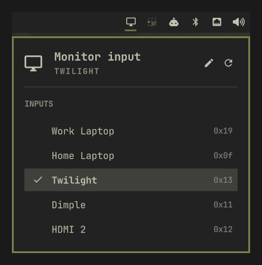

# ddc-input-select

Switch the active input on a DDC/CI monitor from your bar (or any keybind), with
friendly names instead of `DP-1` / `HDMI-2`.

The monitor is asked what inputs it has, so there is nothing to configure to get
started. Developed against a Dell U5226KW, which is the only monitor it has been
tested on.



*The Omarchy Quattro bar plugin. The names are yours; the codes on the right are
what the monitor reports.*

Two front ends share one optional config file:

- **`bin/ddc-input-select`** — a bash wrapper around
  [`ddcutil`](https://www.ddcutil.com/) that uses
  [`walker`](https://github.com/abenz1267/walker) as a dmenu-style picker. Use
  it from a keybind, a terminal, or a waybar `on-click`.
- **An Omarchy Quattro bar plugin** — a native `omarchy-shell` bar widget with
  its own popup. No walker, no jq, no shell script. See
  [Omarchy Quattro plugin](#omarchy-quattro-plugin).

Waybar users on Omarchy 2/3 want the script; Quattro replaced waybar with
`omarchy-shell`, so on Quattro you want the plugin.

Inspired by [coralnode/delldispctl](https://github.com/coralnode/delldispctl),
which targets traditional desktops via a GTK system-tray icon. This project
covers the same use case for Hyprland/waybar.

## Requirements

- Any monitor that speaks DDC/CI and reports VCP feature `0x60` (Input Source)
  in its capabilities string — which is how the input list is discovered.
- `ddcutil` — talks to the monitor over DDC/CI. Your user must be able to read
  and write `/dev/i2c-*`; on most distros that means joining the `i2c` group
  and loading the `i2c-dev` kernel module.
- `walker` — CLI only. The picker UI; any dmenu-compatible launcher
  (`wofi --dmenu`, `fuzzel --dmenu`, etc.) works with a one-line edit to
  `bin/ddc-input-select`.
- `jq` — CLI only. JSON parsing.
- `notify-send` (e.g. `mako`, `dunst`) — CLI only, optional; success/error feedback.

The Quattro plugin needs only `ddcutil` and Omarchy 4.x.

## Install

```sh
make install
```

This installs `ddc-input-select` to `~/.local/bin/`. Uninstall with
`make uninstall` (config is left in place).

## Configure

Nothing is required — run it and you'll get whatever your monitor reports, under
the names MCCS assigns to standard input codes:

```
$ ddc-input-select --list
0x19	Input 0x19
0x0f	DisplayPort-1
0x13	Input 0x13
0x11	HDMI-1
0x12	HDMI-2
```

`Input 0x19` and `Input 0x13` are unnamed because they're vendor extensions —
Dell uses them for Thunderbolt and a second DisplayPort, and MCCS defines neither.
That's what the config file is for. Seed one from the monitor and edit the names:

```sh
mkdir -p ~/.config/ddc-input-select
ddc-input-select --detect > ~/.config/ddc-input-select/inputs.json
```

```json
{
  "inputs": [
    { "code": "0x19", "name": "Thunderbolt" },
    { "code": "0x0F", "name": "DisplayPort 1" },
    { "code": "0x13", "name": "Home Laptop" },
    { "code": "0x11", "name": "Work Laptop" },
    { "code": "0x12", "name": "HDMI 2", "hidden": true }
  ]
}
```

The config is an **overlay**, not the source of truth:

- The monitor decides what exists. Anything it reports that you didn't mention
  is appended under its standard name, so a new input can't go missing.
- You decide naming and order. Config entries come first, in the order written.
- `"hidden": true` drops an entry from the picker. It's still resolved by
  `--current` — an input you chose not to list is still one you can be sitting on.
- An entry the monitor never reported is kept, not dropped (capability strings do
  under-report), but the plugin dims it and marks the code with `?`.
- `"bind"` gives an input its own keyboard shortcut. Only the Quattro plugin
  reads it — see [Per-input shortcuts](#per-input-shortcuts).

For reference, the codes a Dell U5226KW reports — note that `0x13` and `0x19`
are outside the MCCS standard, which is exactly why detection beats a hardcoded
table:

| Code   | MCCS name       | Dell's actual input |
| ------ | --------------- | ------------------- |
| `0x19` | *(vendor)*      | Thunderbolt         |
| `0x0F` | DisplayPort-1   | DisplayPort 1       |
| `0x13` | *(vendor)*      | DisplayPort 2       |
| `0x11` | HDMI-1          | HDMI 1              |
| `0x12` | HDMI-2          | HDMI 2              |

## Omarchy Quattro plugin

Quattro's bar is [Quickshell](https://quickshell.org/)-based: everything in it
is a plugin loaded into the single long-running `omarchy-shell` process, so
there is no waybar `custom/` module to hang a script off. This repo doubles as
that plugin — `manifest.json`, `Panel.qml`, and `Model.js` at the repo root are
the whole thing.

```sh
make install-plugin
omarchy plugin enable io.github.mattflower.ddc-input-select right
```

Or, once this is pushed, straight from git:

```sh
omarchy plugin add https://github.com/MattFlower/omarchy-ddc-input-select.git --enable --yes
```

The widget puts a 󰍹 icon in the bar. Left click opens a popup listing your
inputs with the active one checked; click or arrow-and-Enter to switch. Middle
click re-detects. Scrolling the icon nudges monitor brightness (VCP `0x10`),
carrying over the `on-scroll` bindings from the old waybar module.

A pencil icon sits beside the refresh icon in the popup header and opens the
config in your Omarchy editor. With no config yet it creates the directory and
file first — seeded with everything the monitor reported — so you land in a
filled-in file and only have to replace names. Its tooltip says which of the two
it will do, and names the path. It's also the last stop in the keyboard cursor,
one step past the final input.

Discovery runs on the first open of each shell session and is cached from then
on — the monitor's input list doesn't change between reboots. Later opens only
re-read which input is live; the refresh control forces a full re-probe.

It reads the same optional `~/.config/ddc-input-select/inputs.json` as the CLI,
watches it for changes, and talks to `ddcutil` directly — so the plugin has no
dependency on `bin/ddc-input-select`, `walker`, or `jq`. Install both if you
also want the keybind path.

Settings live under Setup > Plugins (or inline on the widget's entry in
`~/.config/omarchy/shell.json`):

| Setting          | Default | Meaning                                                     |
| ---------------- | ------- | ----------------------------------------------------------- |
| `displayNumber`  | `0`     | `ddcutil --display N`; `0` lets ddcutil pick. Set this if you have more than one DDC monitor. |
| `busNumber`      | `0`     | `ddcutil --bus N` (the `/dev/i2c-N` from `ddcutil detect`). Wins over `displayNumber`. For setups where the display number shifts, e.g. behind a dock that doesn't pass DDC/CI through. `0` turns it off. |
| `showLabel`      | `false` | Print the active input's name next to the icon.             |
| `brightnessStep` | `10`    | Scroll step for brightness; `0` disables scroll control.    |
| `configPath`     | `""`    | Override the inputs JSON path.                              |

`allowMultiple` is on, so a second instance pointed at a different
`displayNumber` gives you one widget per monitor.

The popup is also reachable over IPC, which makes it bindable in
`~/.config/hypr/bindings.conf`:

```sh
omarchy-shell ddc-input toggle
```

Switching straight to an input works the same way, by code or by name (the
names from your config, or the standard ones such as `HDMI-1`):

```sh
omarchy-shell ddc-input set 0x11
omarchy-shell ddc-input set "Work Laptop"
```

It prints `ok`, `busy` (another DDC call is still running) or `unknown input`.

### Per-input shortcuts

The gear in the popup header (or `s`) opens the **Shortcuts** page in place of
the input list. It lists every input, hidden ones included, with its shortcut.
Pick one by click or arrow-and-Enter to edit it below the list. The arrow
button or Escape goes back.

- Toggle the modifiers `SUPER`, `CTRL`, `ALT` and `SHIFT`, then press the key
  on its own. The editor starts out listening, so it's usually pick the input,
  press `2`, Save.
  - Modifiers are toggles, not recorded, because Hyprland consumes a
    combination that is already bound (such as the input's current shortcut)
    before the popup sees it. Modifiers you do hold while pressing are picked up.
  - Backspace clears the key, and Escape stops listening.
- Save is disabled while the shortcut has no modifier, or another input
  already uses it.
- If Hyprland already binds the combination to something else (from
  `hyprctl binds`), the editor names it. Saving is still allowed.
- Save writes the shortcut into `inputs.json`. An input that isn't listed
  there yet is added under the name the popup shows. Remove deletes the
  shortcut.

Under the hood each shortcut is a `"bind"` on its input in `inputs.json`, in
the same key syntax Omarchy's `bindings.lua` uses, so it can also be written
by hand:

```json
{
  "inputs": [
    { "code": "0x0F", "name": "DisplayPort", "bind": "SHIFT + CTRL + 1" },
    { "code": "0x11", "name": "Work Laptop", "bind": "SHIFT + CTRL + 2" },
    { "code": "0x12", "name": "HDMI 2", "hidden": true, "bind": "SHIFT + CTRL + 3" }
  ]
}
```

The plugin turns these into `~/.config/hypr/ddc-input-select.lua`, one
`o.bind()` per input calling `omarchy-shell ddc-input set <code>`, and runs
`hyprctl reload` whenever that file changes. Load it once from
`~/.config/hypr/bindings.lua`:

```lua
require("hypr.ddc-input-select")
```

Until that line is there, the Shortcuts page says so.

- The plugin writes only that one file and never touches `bindings.lua` itself.
  Nothing is created until the first `bind` exists.
- Removing every `bind` leaves an empty module behind, so the `require` keeps
  working.
- A config that isn't valid JSON leaves the file as it was. A typo while
  editing doesn't wipe working shortcuts.
- Hidden inputs keep their shortcut. Hiding only affects the popup list.
- The shortcuts go through the running shell, so the plugin has to be enabled
  for them to work.

### Hacking on it

```sh
make test            # unit-test the parsing in Model.js under node
make check-plugin    # validate manifest + qmllint against the Quattro shell
make install-plugin  # copy in and ask the shell to rescan
omarchy-restart-shell                       # when the reload doesn't take (see below)
journalctl --user -f | grep omarchy-shell   # QML errors land here
```

**Hot reload is not always enough.** The shell logs `Local plugin changed,
reloading` and keeps rendering the previous component — observed with a change
that added new items to the popup's layout, which simply never appeared, with no
error anywhere. If an edit doesn't show up, don't debug the edit; run
`omarchy-restart-shell` and look again. A cheap way to tell the two apart is to
change a visible string you already have on screen in the same build — if that
string doesn't change either, you're looking at a stale component, not a bug.

Plugins run unsandboxed inside `omarchy-shell`, so a QML error takes out the
widget, not the bar — but the journal is the only place you'll see it.

All parsing lives in `Model.js` with no QML types, so `make test` can exercise
it under plain node against verbatim `ddcutil` output.

DDC round trips cost roughly 0.5s for a capabilities read and 3s for a `getvcp`,
and the i2c bus serializes them, so every `ddcutil` call goes through an async
`Process` behind a busy guard, discovery and the current-input read are chained
rather than fired together, and nothing is polled on a background timer.

One parsing note worth keeping: `ddcutil capabilities` is parsed from the raw
capabilities string (`--terse`), not the pretty-printed output. On the U5226KW
the pretty form contains raw non-UTF-8 bytes from an unrelated feature (`0x62`,
speaker volume), enough that `file` classifies it as binary and `grep` switches
to binary mode.

## Waybar integration (Omarchy 2/3)

Add to `~/.config/waybar/config.jsonc`:

```jsonc
"custom/monitor-input": {
  "format": "󰍹",
  "tooltip": "Switch monitor input",
  "on-click": "ddc-input-select"
}
```

Then add `"custom/monitor-input"` to your `modules-right` (or wherever you
want it).

For consistent spacing with the rest of the bar, give the module the same
margin treatment as your other custom icons in `~/.config/waybar/style.css`:

```css
#cpu,
#battery,
#pulseaudio,
#custom-monitor-input {
  min-width: 12px;
  margin-right: 16px;
}
```

Reload waybar to pick up the changes:

```sh
pkill -SIGUSR2 waybar
```

## CLI

```
ddc-input-select            # open picker, switch on selection
ddc-input-select --current  # print "<code>\t<name>" for the active input
ddc-input-select --list     # print all (non-hidden) available inputs
ddc-input-select --detect   # print a config skeleton from the monitor itself
ddc-input-select --help
```

Set `DDC_DISPLAY=N` (numbered as in `ddcutil detect`) to target one monitor when
you have several.

You can also bind it directly in `~/.config/hypr/bindings.conf`:

```
bind = SUPER, M, exec, ddc-input-select
```

## Notes

- DDC/CI does not expose "which inputs have a live signal" on this monitor, so
  the picker shows every input the monitor has rather than only-connected
  sources.
- The plugin and the CLI implement the same merge rules independently — QML/JS
  in `Model.js`, bash in `bin/ddc-input-select` — because neither runtime can
  call the other. `make test` covers the JS side; the bash side is small enough
  to read in one sitting.
